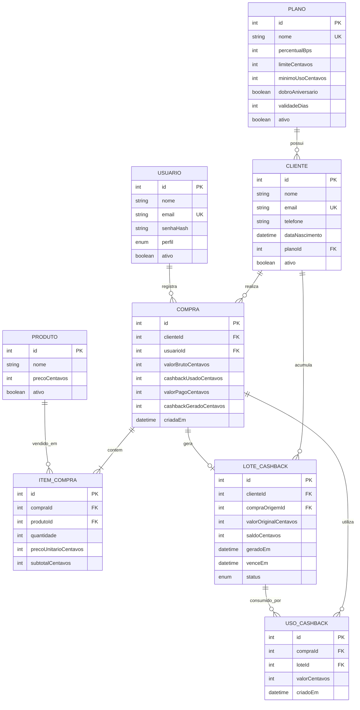
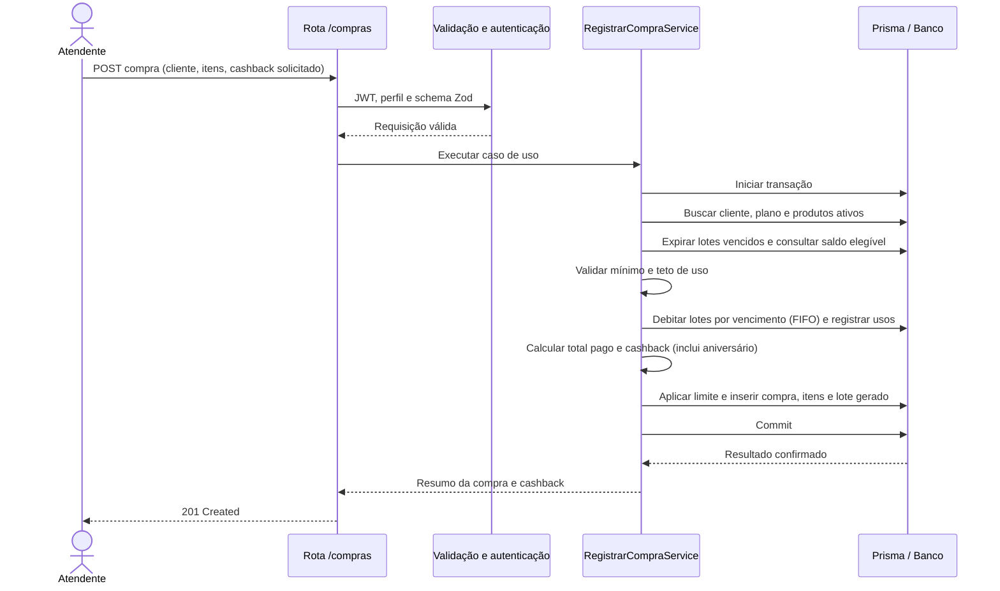

# Grão a Grão — Arquitetura da API

> Documento de arquitetura proposta para o sistema de cashback Grão a Grão. Este arquivo descreve a organização, os dados e os contratos planejados para o projeto.

## 1. Visão geral

Grão a Grão é uma API REST para um programa de fidelidade de cafeterias. O cliente possui um plano, acumula cashback a partir das compras elegíveis e pode usar o saldo em compras futuras. O sistema mantém lotes de cashback com vencimento individual, aplica consumo FIFO (primeiro a vencer/gerar, primeiro a usar), respeita limites de saldo e regras especiais de cada plano.

A API será consumida por uma interface de atendimento/administração. Ela centraliza clientes, planos, produtos, autenticação, compras e extrato. O principal desafio de negócio é processar uma compra e seus efeitos financeiros de cashback sem deixar dados inconsistentes.

## 2. Arquitetura em camadas

O projeto adota arquitetura em camadas, com dependências fluindo das rotas para o domínio e para a persistência. Express trata HTTP; serviços concentram regras; Prisma é acessado pelos repositórios.

| Camada | Responsabilidade |
|---|---|
| `routes` | Declarar método, caminho, autenticação/perfil, validação e controlador. Não contém regra de negócio. |
| `controllers` | Adaptar HTTP para chamadas de serviço e mapear o resultado para status e corpo da resposta. |
| `services` | Executar casos de uso e regras de negócio, incluindo cálculo do cashback, validade, limite e troca de plano. |
| `repositories` | Consultar e persistir entidades via Prisma. Abstraem detalhes do banco e permitem transações nos casos de uso que precisam delas. |
| `middlewares` | Autenticar JWT, autorizar perfil, validar requisições, tratar erros e configurar segurança HTTP. |
| `validators` / `dtos` | Validar e tipar entradas e saídas. Zod valida corpo, parâmetros e query antes do serviço. DTOs evitam expor campos internos, como hash de senha. |
| `errors` | Definir erros de aplicação (não encontrado, validação, conflito, não autenticado e não autorizado) e o formato padronizado de erro. |
| `config` | Carregar e validar variáveis de ambiente e centralizar configurações de servidor, CORS, JWT e banco. |
| `prisma` | Schema, migrations, seed e instanciação do Prisma Client/adapter. |

Essa separação torna as regras testáveis sem acoplá-las a Express, mantém o acesso ao banco em um ponto definido e torna as responsabilidades legíveis para um grupo de quatro integrantes. Valores monetários devem ser guardados em centavos inteiros; datas devem ser persistidas em UTC e exibidas em formato ISO 8601.

## 3. Padrões e organização

- **Repository:** encapsula operações de persistência por agregado (clientes, planos, produtos e compras/cashback).
- **Service Layer:** cada caso de uso fica em um serviço; por exemplo, `RegistrarCompraService` coordena compra, débito e crédito de cashback.
- **DTO:** os contratos HTTP são separados dos modelos Prisma. Respostas não incluem `senhaHash` ou dados internos.
- **Injeção de dependência simples:** serviços recebem repositórios (e, quando aplicável, um cliente/transação Prisma) por construtor ou parâmetros. Evitar contêiner complexo nesta escala.
- **Erros centralizados:** controladores encaminham erros ao middleware final; um único ponto converte erros conhecidos em respostas JSON e erros inesperados em 500 sem revelar detalhes internos.
- **Transação:** operações financeiras relacionadas são executadas atomicamente em uma transação Prisma.

## 4. Estrutura de pastas proposta

Estrutura proposta para o projeto Grão a Grão. Os arquivos seguem nomes em PascalCase, como `AuthService.ts`:

```text
grao-a-grao/
├── prisma/
│   ├── migrations/
│   ├── schema.prisma
│   └── seed.ts
├── src/
│   ├── App.ts
│   ├── Server.ts
│   ├── config/
│   │   ├── Env.ts
│   │   └── Security.ts
│   ├── prisma/
│   │   └── PrismaClient.ts
│   ├── routes/
│   │   ├── Routes.ts
│   │   ├── AuthRoutes.ts
│   │   ├── ClientesRoutes.ts
│   │   ├── PlanosRoutes.ts
│   │   ├── ProdutosRoutes.ts
│   │   └── ComprasRoutes.ts
│   ├── controllers/
│   │   ├── AuthController.ts
│   │   ├── ClientesController.ts
│   │   ├── PlanosController.ts
│   │   ├── ProdutosController.ts
│   │   └── ComprasController.ts
│   ├── services/
│   │   ├── AuthService.ts
│   │   ├── ClientesService.ts
│   │   ├── PlanosService.ts
│   │   ├── ProdutosService.ts
│   │   ├── RegistrarCompraService.ts
│   │   ├── ExtratoService.ts
│   │   └── TrocarPlanoService.ts
│   ├── repositories/
│   │   ├── UsuariosRepository.ts
│   │   ├── ClientesRepository.ts
│   │   ├── PlanosRepository.ts
│   │   ├── ProdutosRepository.ts
│   │   └── ComprasRepository.ts
│   ├── middlewares/
│   │   ├── Authenticate.ts
│   │   ├── AuthorizeRole.ts
│   │   ├── Validate.ts
│   │   ├── NotFound.ts
│   │   └── ErrorHandler.ts
│   ├── validators/
│   │   ├── AuthSchemas.ts
│   │   ├── ClienteSchemas.ts
│   │   ├── PlanoSchemas.ts
│   │   ├── ProdutoSchemas.ts
│   │   └── CompraSchemas.ts
│   ├── dtos/
│   ├── errors/
│   │   ├── AppError.ts
│   │   └── ErrorCodes.ts
│   └── docs/
│       └── OpenApi.ts
├── .env.example
├── ARQUITETURA.md
├── README.md
├── package.json
└── tsconfig.json
```

## 5. Modelo de dados proposto

IDs são inteiros autoincrementais. Valores em dinheiro (`valorCentavos`, `saldoCentavos`, `limiteCentavos`, `minimoUsoCentavos`) são inteiros não negativos. Percentuais são armazenados em pontos-base (2% = 200) para evitar arredondamento binário; o arredondamento do cashback é para baixo ao centavo. Índices únicos e relacionais abaixo devem ser refletidos no Prisma.

| Tabela | Campos principais e tipos | Relações e índices |
|---|---|---|
| `Usuario` | `id Int`; `nome String`; `email String`; `senhaHash String`; `perfil Enum(ADMIN, ATENDENTE)`; `ativo Boolean`; `criadoEm DateTime`; `atualizadoEm DateTime` | `email` único. Usuário é a conta operacional que acessa a API. |
| `Cliente` | `id Int`; `nome String`; `email String?`; `telefone String?`; `dataNascimento DateTime?`; `planoId Int`; `criadoEm DateTime`; `atualizadoEm DateTime`; `ativo Boolean` | N:1 `Plano`; 1:N `Compra` e `LoteCashback`. `email` opcional único; índice em `planoId`. |
| `Plano` | `id Int`; `nome String`; `percentualBps Int`; `limiteCentavos Int`; `minimoUsoCentavos Int`; `dobroAniversario Boolean`; `validadeDias Int` (padrão 180); `ativo Boolean`; `criadoEm DateTime`; `atualizadoEm DateTime` | 1:N `Cliente`. Nome único; percentual, limite e validade indexáveis conforme consulta administrativa. |
| `Produto` | `id Int`; `nome String`; `descricao String?`; `precoCentavos Int`; `ativo Boolean`; `criadoEm DateTime`; `atualizadoEm DateTime` | 1:N `ItemCompra`. Índices em nome e ativo. |
| `Compra` | `id Int`; `clienteId Int`; `usuarioId Int`; `valorBrutoCentavos Int`; `cashbackUsadoCentavos Int`; `valorPagoCentavos Int`; `cashbackGeradoCentavos Int`; `criadaEm DateTime` | N:1 `Cliente`, N:1 `Usuario`; 1:N `ItemCompra`, 1:N `UsoCashback`, 0:1 `LoteCashback` gerado. Índices em `clienteId, criadaEm` e `usuarioId, criadaEm`. |
| `ItemCompra` | `id Int`; `compraId Int`; `produtoId Int`; `quantidade Int`; `precoUnitarioCentavos Int`; `subtotalCentavos Int` | N:1 `Compra` e N:1 `Produto`; índice em `compraId`. Preço unitário fica como snapshot, preservando histórico se o preço do produto mudar. |
| `LoteCashback` | `id Int`; `clienteId Int`; `compraOrigemId Int`; `valorOriginalCentavos Int`; `saldoCentavos Int`; `geradoEm DateTime`; `venceEm DateTime`; `status Enum(ATIVO, PARCIAL, CONSUMIDO, EXPIRADO)` | N:1 `Cliente`; 1:1 opcional `Compra` de origem; 1:N `UsoCashback`. Índices compostos em `clienteId, status, venceEm` e `clienteId, geradoEm`. `saldoCentavos` é o restante utilizável. |
| `UsoCashback` | `id Int`; `compraId Int`; `loteId Int`; `valorCentavos Int`; `criadoEm DateTime` | N:1 `Compra` e N:1 `LoteCashback`; índices em `compraId` e `loteId`. Registra quanto cada compra consumiu de cada lote e permite auditar FIFO. |

O saldo atual é a soma de `saldoCentavos` dos lotes não vencidos e com status `ATIVO` ou `PARCIAL`. A expiração deve ser materializada atualizando lotes elegíveis para `EXPIRADO` e zerando seu saldo dentro do fluxo de consulta/compra ou por rotina agendada. A consulta também deve ignorar vencidos mesmo antes da atualização materializada.



### Planos iniciais

| Plano | Cashback | Limite de saldo | Mínimo para uso | Bônus de aniversário | Validade |
|---|---:|---:|---:|---|---:|
| Básico | 2% | R$ 200,00 | R$ 20,00 | Não | 6 meses |
| Intermediário | 5% | R$ 500,00 | R$ 20,00* | Sim, percentual em dobro | 6 meses |
| Premium | 8% | R$ 1.000,00 | R$ 0,00 | Sim, percentual em dobro | 6 meses |

\* O prompt define mínimo explicitamente para Básico e Premium. Para manter a regra de validação uniforme, o modelo de dados propõe R$ 20,00 para Intermediário; esse padrão pode ser alterado pelo administrador.

## 6. Endpoints planejados

Todas as rotas retornam JSON. `ADMIN` tem acesso administrativo; `ATENDENTE` atende clientes, consulta dados e registra compras. `Público` não exige JWT. Códigos representam respostas principais, além de `500` em falha inesperada tratada pelo middleware.

| Método | Rota | Descrição | Autenticação | Perfil | Respostas principais |
|---|---|---|---|---|---|
| POST | `/auth/register` | Cadastra usuário operacional. Criar usuário como `ATENDENTE`; primeiro admin deve ser provisionado por seed/configuração controlada. | Não | Público | 201, 400, 409 |
| POST | `/auth/login` | Valida credenciais e retorna JWT. | Não | Público | 200, 400, 401 |
| POST | `/clientes` | Cadastra cliente associado a um plano ativo. | Sim | ADMIN, ATENDENTE | 201, 400, 401, 403, 409 |
| GET | `/clientes` | Lista clientes com paginação/filtros. | Sim | ADMIN, ATENDENTE | 200, 401, 403 |
| GET | `/clientes/:id` | Busca cliente por ID. | Sim | ADMIN, ATENDENTE | 200, 401, 403, 404 |
| PUT | `/clientes/:id` | Atualiza dados cadastrais do cliente. | Sim | ADMIN, ATENDENTE | 200, 400, 401, 403, 404, 409 |
| DELETE | `/clientes/:id` | Desativa cliente (exclusão lógica para preservar compras/extrato). | Sim | ADMIN | 204, 401, 403, 404 |
| POST | `/planos` | Cadastra plano e suas regras. | Sim | ADMIN | 201, 400, 401, 403, 409 |
| GET | `/planos` | Lista planos, com opção de incluir inativos para admin. | Sim | ADMIN, ATENDENTE | 200, 401, 403 |
| GET | `/planos/:id` | Busca plano por ID. | Sim | ADMIN, ATENDENTE | 200, 401, 403, 404 |
| PUT | `/planos/:id` | Atualiza regras do plano; não altera retroativamente compras/lotes já gerados. | Sim | ADMIN | 200, 400, 401, 403, 404, 409 |
| DELETE | `/planos/:id` | Desativa plano; não remove histórico nem plano usado por clientes. | Sim | ADMIN | 204, 401, 403, 404, 409 |
| POST | `/produtos` | Cadastra produto. | Sim | ADMIN | 201, 400, 401, 403, 409 |
| GET | `/produtos` | Lista produtos ativos, com paginação/filtros. | Sim | ADMIN, ATENDENTE | 200, 401, 403 |
| GET | `/produtos/:id` | Busca produto por ID. | Sim | ADMIN, ATENDENTE | 200, 401, 403, 404 |
| PUT | `/produtos/:id` | Atualiza produto; compras preservam o preço histórico do item. | Sim | ADMIN | 200, 400, 401, 403, 404, 409 |
| DELETE | `/produtos/:id` | Desativa produto para novas vendas. | Sim | ADMIN | 204, 401, 403, 404 |
| POST | `/compras` | Registra compra, consumo FIFO e geração de cashback atomicamente. | Sim | ADMIN, ATENDENTE | 201, 400, 401, 403, 404, 409 |
| GET | `/clientes/:id/extrato` | Exibe saldo disponível, lotes a vencer e histórico de créditos, usos e expirações. | Sim | ADMIN, ATENDENTE | 200, 401, 403, 404 |
| POST | `/clientes/:id/trocar-plano` | Muda cliente para plano ativo sem apagar saldo; respeita o limite novo nas próximas compras. | Sim | ADMIN | 200, 400, 401, 403, 404 |

### Contrato essencial de `POST /compras`

O corpo deve conter `clienteId`, itens (`produtoId`, `quantidade`) e, opcionalmente, `cashbackSolicitadoCentavos`. O sistema usa preços atuais dos produtos ativos; o atendente não informa preço arbitrário. A resposta deve informar compra, valor bruto, cashback usado, valor pago, cashback gerado e motivo quando nenhum cashback puder ser gerado.

## 7. Fluxo detalhado de `POST /compras`

1. Middleware valida JWT e perfil. Zod valida tipos, IDs positivos, quantidade inteira positiva, lista não vazia e ausência de campos inesperados.
2. Serviço inicia transação no banco. Busca cliente ativo, plano ativo e produtos ativos; falha com 404/409 se houver referência inválida ou produto indisponível.
3. Recalcula subtotal com preço cadastrado e quantidade. Não confia em totais enviados pelo cliente. Soma subtotais para obter valor bruto em centavos.
4. Marca como expirados os lotes do cliente cujo `venceEm` já passou e ignora seus saldos. A mesma transação lê/atualiza os lotes e bloqueia concorrência para evitar dupla utilização do mesmo saldo.
5. Calcula saldo utilizável somando lotes ativos/parciais. Cashback solicitado não pode exceder saldo disponível nem valor bruto da compra. Se o valor a usar for menor que o mínimo do plano, rejeita o uso; para planos com mínimo zero, o uso pode ser parcial a partir de um centavo.
6. Consome lotes em ordem crescente de `venceEm`, depois `geradoEm` e `id` (FIFO determinístico). Para cada lote, cria `UsoCashback`, subtrai do saldo e atualiza status para `CONSUMIDO` se zerado, ou `PARCIAL` caso reste saldo.
7. Calcula `valorPago = valorBruto - cashbackUsado`.
8. Calcula o percentual do plano. No mês de aniversário, planos com bônus aplicam o dobro. Cashback bruto é arredondado para baixo ao centavo.
9. Soma o saldo remanescente não vencido após o débito. Gera lote somente se cliente não estiver no limite do plano. O crédito é limitado ao espaço disponível (`limite - saldoAtual`); o excedente não é creditado. Se não houver espaço, cashback gerado é zero e a resposta informa que o cliente precisa usar o saldo. Se houver espaço parcial, credita apenas o espaço restante e informa eventual limite atingido.
10. Cria registro da compra, seus itens com snapshot de preço e o lote de crédito (se maior que zero). O uso e a geração ficam vinculados à compra.
11. Confirma a transação e responde `201`. Qualquer falha antes do commit desfaz compra, itens, débitos, usos, expirações e crédito.



**Concorrência:** duas compras simultâneas do mesmo cliente não podem gastar o mesmo lote nem ultrapassar o limite. A implementação deve serializar a leitura/atualização por cliente usando isolamento/transação e bloqueio compatível com o banco escolhido, ou estratégia equivalente com atualização condicional e retentativa em conflito. A transação precisa cobrir toda a operação.

## 8. Segurança e requisitos do trabalho

| Medida | Aplicação | Requisito atendido |
|---|---|---|
| JWT | Token assinado com segredo fora do repositório, expiração curta e validação em rotas privadas. | Autenticação e controle de acesso. |
| Perfis `ADMIN` e `ATENDENTE` | Middleware autoriza operações conforme função; somente admin altera planos e regras. | Controle de acesso. |
| Hash de senha com bcrypt | Armazenar apenas hash com custo configurado; nunca retornar hash em DTO. | Proteção das informações. |
| Zod | Validar corpo, parâmetros e query antes da regra de negócio; rejeitar valores inválidos e entradas inesperadas. | Validação de entrada. |
| Erros padronizados | Middleware global mapeia falhas conhecidas para status e mensagens seguras; logs internos sem stack trace ao cliente. | Tratamento de erros. |
| `.env` e validação de configuração | Segredos, URL do banco, chave JWT e origens permitidas ficam em variáveis de ambiente; `.env` não entra no Git. | Proteção de informações sensíveis. |
| Helmet e CORS | Cabeçalhos HTTP seguros e lista explícita de origens autorizadas. | Segurança básica da API. |
| Prisma e consultas parametrizadas | Acesso ao banco por ORM, evitando concatenação manual de SQL; restringir campos selecionáveis. | Proteção contra entrada maliciosa e exposição indevida. |
| Dados mínimos e DTOs | Senha/hash e dados internos não aparecem em listagens ou respostas; paginação limita volume. | Proteção das informações. |
| Transação e integridade | Compra, itens, consumo e geração de cashback são atômicos e auditáveis. | Correção da regra principal e consistência. |

## 9. Divisão sugerida entre quatro integrantes

| Integrante | Responsabilidade principal | Entregas compartilháveis |
|---|---|---|
| 1 — Base e segurança | Configuração Express/TypeScript/Prisma, conexão MySQL, variáveis de ambiente, JWT, bcrypt, perfis e middleware de erro. | Esqueleto de aplicação, auth e documentação de execução. |
| 2 — Cadastros | CRUD de clientes e planos, validações, regras para desativação e troca de plano. | Migrations/modelos e documentação dos endpoints desses recursos. |
| 3 — Catálogo e compras | CRUD de produtos, itens de compra e caso de uso transacional de compra, limites e FIFO. | Fluxos de compra e exemplos para demonstração. |
| 4 — Extrato e integração | Extrato e validade de lotes, seed dos planos, OpenAPI/Swagger, integração entre módulos e revisão do README. | Cenário demonstrável de vencimento, limite e FIFO. |

Todos devem revisar contratos dos DTOs, modelo Prisma e erros em conjunto. O caso de compra envolve módulos de cliente, plano, produto e cashback; portanto, os integrantes 2–4 devem alinhar nomes de campos e contratos antes da integração.
