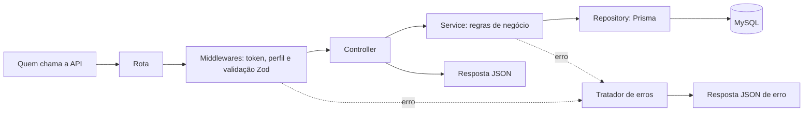
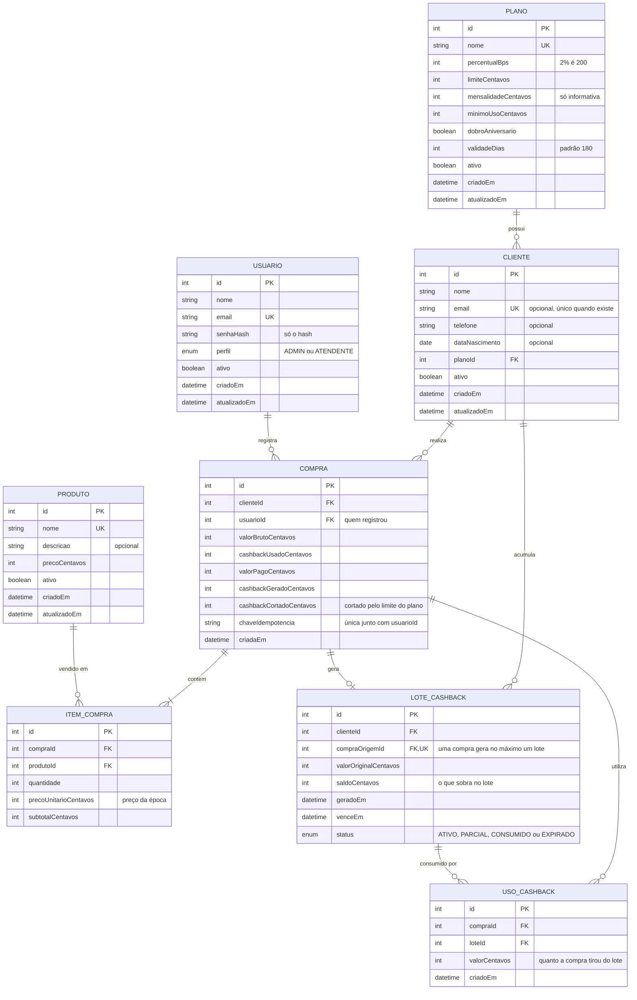
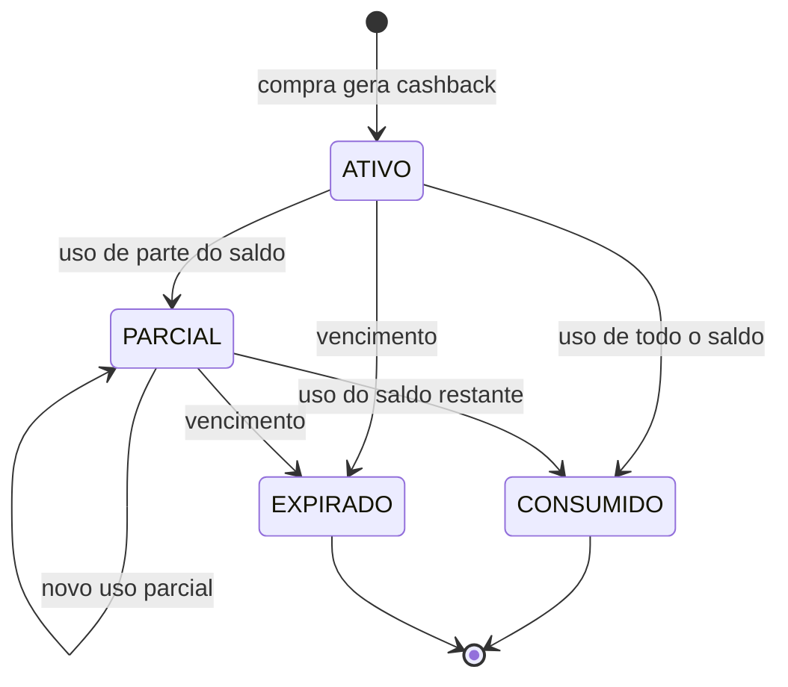
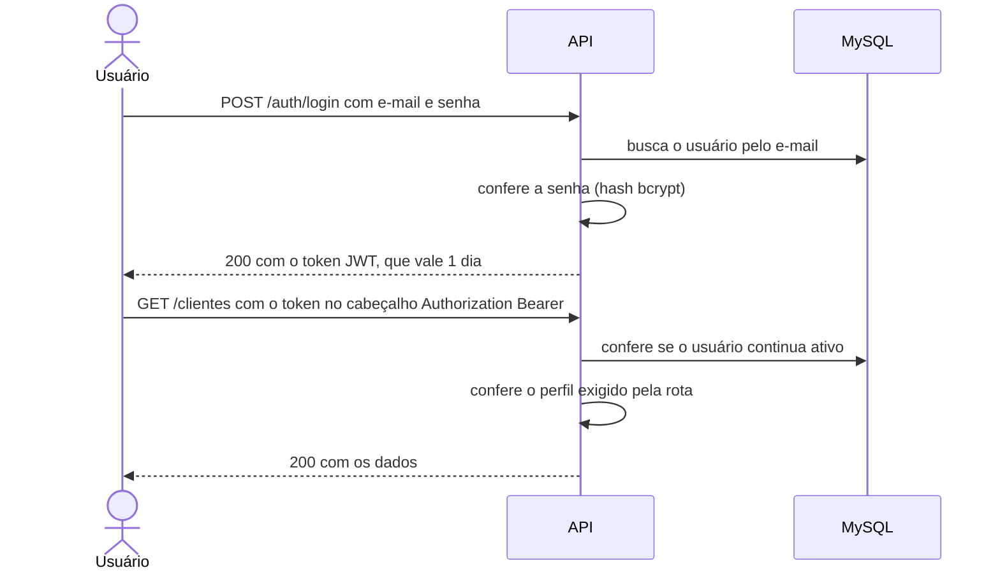
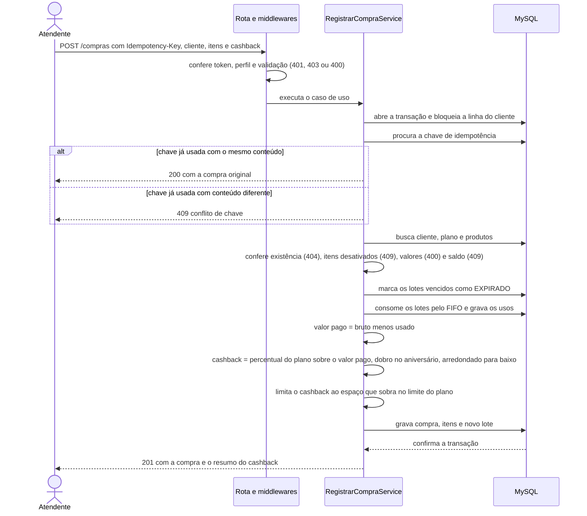

# Visão geral da API

Explicação da API em linguagem simples, com o diagrama do banco e os fluxos principais, desenhados em Mermaid. Este arquivo **resume e não cria regras**: em caso de divergência, valem os arquivos de origem indicados em cada seção.

- **Versão:** 0.1
- **Data:** 2026-11-09
- **Status:** `proposto` (aguarda confirmação).

---

## 1. O que a API faz

**Grão a Grão** é uma API REST para um programa de **cashback de cafeterias**. Ela guarda clientes, planos, produtos, compras e o saldo de cashback, e aplica as regras do programa sempre do mesmo jeito, sem depender de quem atende. O contexto completo está em [contexto.md](../negocio/contexto.md).

Como o programa funciona:

1. Cada cliente pertence a **um plano** (Básico, Intermediário ou Premium), que tem uma mensalidade só informativa e define quanto ele ganha, quanto pode acumular e quanto precisa juntar para usar.
2. Cada **compra** gera cashback, que vira um **lote** com data de vencimento (180 dias, por padrão).
3. Nas compras seguintes, o cliente pode **usar o saldo**. A API gasta primeiro o lote que vence antes (**FIFO**).
4. O saldo tem um **limite** por plano, e lote **vencido** deixa de valer.
5. No **mês de aniversário**, os planos Intermediário e Premium ganham o dobro do percentual.

As regras completas estão em [regrasDeNegocio.md](../negocio/regrasDeNegocio.md).

### Exemplo de uma compra

Cliente do plano Básico (2% de cashback) com pelo menos R$ 20,00 de saldo:

| Passo | Valor | Em centavos |
|---|---|---|
| Valor bruto da compra | R$ 100,00 | 10000 |
| Cashback usado | R$ 20,00 | 2000 |
| **Valor pago** (bruto − usado) | R$ 80,00 | 8000 |
| **Cashback gerado** (2% sobre o valor pago, arredondado para baixo) | R$ 1,60 | 160 |

O cashback gerado vira um novo lote, que vence 180 dias depois. O cashback é calculado sobre o valor pago, para não gerar cashback sobre cashback.

## 2. Quem usa

| Perfil | O que faz |
|---|---|
| **ATENDENTE** | Atende no balcão: cadastra e atualiza clientes, consulta planos, produtos e extrato, e registra compras. |
| **ADMIN** | Tudo o que o atendente faz, mais: planos, produtos, desativar e reativar itens, trocar o plano de um cliente e cadastrar usuários. |

A API é consumida por uma interface de atendimento e administração, que não faz parte do projeto. Os perfis estão em [seguranca.md](../seguranca/seguranca.md).

## 3. Mapa das rotas

São **24 rotas**. A lista completa, com quem pode usar cada uma e as respostas, está em [endpoints.md](../api/endpoints.md). Os campos de entrada e saída estão em [contratos.md](../api/contratos.md).

| Grupo | Rotas | O que faz | Quem |
|---|---|---|---|
| Acesso | 2 | Entrar no sistema (`POST /auth/login`) e cadastrar um atendente (`POST /auth/register`). | Público e ADMIN |
| Clientes | 7 | Cadastrar, listar, consultar, atualizar, desativar, trocar de plano e ver o extrato. | Ambos; desativar e trocar plano só ADMIN |
| Planos | 5 | Cadastrar, listar, consultar, atualizar e desativar. | Leitura para ambos; escrita só ADMIN |
| Produtos | 5 | Cadastrar, listar, consultar, atualizar e desativar. | Leitura para ambos; escrita só ADMIN |
| Reativação | 3 | `POST /clientes/:id/reativar`, `POST /planos/:id/reativar` e `POST /produtos/:id/reativar`. | ADMIN |
| Compras | 1 | `POST /compras`: registra a compra, usa o saldo e gera o cashback. | Ambos |
| Auxiliares | 1 | `GET /docs`: documentação Swagger. | Público |

Padrões que valem para todas as rotas:

- **Nada é apagado.** `DELETE` desativa o registro e responde `204` sem corpo. Só o ADMIN reativa.
- **Listagens são paginadas** (`pagina` e `limite`). O filtro `incluirInativos=true` é só para o ADMIN.
- **Dinheiro em centavos inteiros** e percentual em pontos-base (2% é 200).
- **Erros têm sempre o mesmo formato**, sem detalhe interno:

```json
{
  "erro": {
    "codigo": "CLIENT_NOT_FOUND",
    "mensagem": "Cliente não encontrado."
  }
}
```

## 4. Como uma requisição percorre a API



| Camada | Faz | Não faz |
|---|---|---|
| **Rota** | Liga método e caminho a autenticação, perfil, validação e controller. | Regra de negócio. |
| **Controller** | Converte a requisição em chamada ao service e escolhe o status da resposta. | Regra de negócio, acesso ao banco. |
| **Service** | Aplica as regras de negócio e coordena a transação. | Conhecer HTTP. |
| **Repository** | É o único lugar que fala com o Prisma. | Regra de negócio. |

As dependências só descem: rota, controller, service, repository. Detalhes e a estrutura de pastas estão em [arquitetura.md](arquitetura.md), e as tecnologias em [stack.md](stack.md).

## 5. Diagrama do banco

O banco é **MySQL 8.4**, acessado só pelo Prisma. São **8 tabelas**. Origem: [modeloDeDados.md](../dados/modeloDeDados.md).



### Como ler as ligações

| Ligação | Significado | Chave |
|---|---|---|
| Plano → Cliente | Um plano tem vários clientes, e cada cliente tem exatamente um plano. | `Cliente.planoId` |
| Cliente → Compra | Um cliente realiza várias compras. | `Compra.clienteId` |
| Usuário → Compra | Um usuário registra várias compras. | `Compra.usuarioId` |
| Compra → ItemCompra | Uma compra tem um ou mais itens. | `ItemCompra.compraId` |
| Produto → ItemCompra | Um produto aparece em vários itens. O item guarda o preço da época. | `ItemCompra.produtoId` |
| Cliente → LoteCashback | Um cliente acumula vários lotes. | `LoteCashback.clienteId` |
| Compra → LoteCashback | Uma compra gera **no máximo um** lote. | `LoteCashback.compraOrigemId` (único) |
| Compra → UsoCashback | Uma compra pode usar saldo de vários lotes. | `UsoCashback.compraId` |
| LoteCashback → UsoCashback | Um lote pode ser usado por várias compras. | `UsoCashback.loteId` |

Pontos de integridade (detalhes em [modeloDeDados.md](../dados/modeloDeDados.md)):

- **Nada é apagado.** Cliente, plano e produto têm o campo `ativo`, e as chaves estrangeiras não apagam em cascata.
- **A compra é atômica.** Compra, itens, usos e novo lote são gravados em uma única transação, com a linha do cliente bloqueada.
- **A chave de idempotência é única por usuário** (`usuarioId` + `chaveIdempotencia`), para a mesma compra enviada duas vezes ser gravada uma só vez.
- **O saldo de um lote nunca fica negativo.**

## 6. Ciclo de vida de um lote de cashback



- **Ativo:** ainda não foi usado. **Parcial:** usado em parte. **Consumido:** usado por inteiro. **Expirado:** venceu, e o valor perdido fica registrado.
- Um lote vencido **não conta no saldo e não pode ser usado**, mesmo antes de ser marcado como expirado. A marcação é gravada dentro da transação da próxima compra do cliente. O extrato só calcula e não grava nada.

## 7. Fluxo de acesso (login)



Quem erra o e-mail ou a senha recebe sempre a mesma resposta (`INVALID_CREDENTIALS`), para não revelar se a conta existe. Detalhes em [seguranca.md](../seguranca/seguranca.md).

## 8. Fluxo de uma compra

Este é o caso de uso principal: `POST /compras`. Origem: [contratos.md](../api/contratos.md) (seção Compra) e [regrasDeNegocio.md](../negocio/regrasDeNegocio.md).



Em palavras:

1. **Entrada.** O atendente envia o cliente, os itens (produto e quantidade) e, se quiser, o cashback a usar. Não informa preço nem total: a API recalcula com os preços do catálogo.
2. **Idempotência.** A mesma compra reenviada com a mesma chave não é gravada de novo: devolve `200` com a compra original. A mesma chave com conteúdo diferente responde `409`.
3. **Verificações, nesta ordem:** existência, itens desativados, valores e saldo. Vale o primeiro problema encontrado. A ordem completa está em [contratos.md](../api/contratos.md).
4. **Uso do saldo.** O cashback usado não passa do saldo nem do valor bruto, e não pode ser menor que o mínimo do plano. Os lotes são gastos por vencimento (depois pela data de geração e pelo identificador).
5. **Geração.** O cashback vem do valor pago. Se o saldo já estiver no limite do plano, nada é gerado, e a resposta informa o motivo e o valor cortado.
6. **Tudo ou nada.** Se qualquer passo falhar antes da confirmação, nada é gravado.

A resposta traz a compra, o cashback calculado, o cortado pelo limite, o saldo depois da compra, se o limite foi atingido e o motivo de nenhum cashback ter sido gerado, quando for o caso.

## 9. Onde ver cada detalhe

| Assunto | Arquivo |
|---|---|
| O problema e o objetivo | [contexto.md](../negocio/contexto.md) |
| Termos do projeto | [glossario.md](../negocio/glossario.md) |
| Regras de negócio (RN) | [regrasDeNegocio.md](../negocio/regrasDeNegocio.md) |
| O que o sistema deve fazer (RF e RNF) | [requisitos.md](../negocio/requisitos.md) |
| Rotas e permissões | [endpoints.md](../api/endpoints.md) |
| Campos, limites, erros e paginação | [contratos.md](../api/contratos.md) |
| Tabelas, índices e migrations | [modeloDeDados.md](../dados/modeloDeDados.md) |
| Segurança | [seguranca.md](../seguranca/seguranca.md) |
| Camadas e pastas | [arquitetura.md](arquitetura.md) |
| Tecnologias e variáveis de ambiente | [stack.md](stack.md) |
| Ordem de construção e testes | [tasks.md](../tasks.md) |
