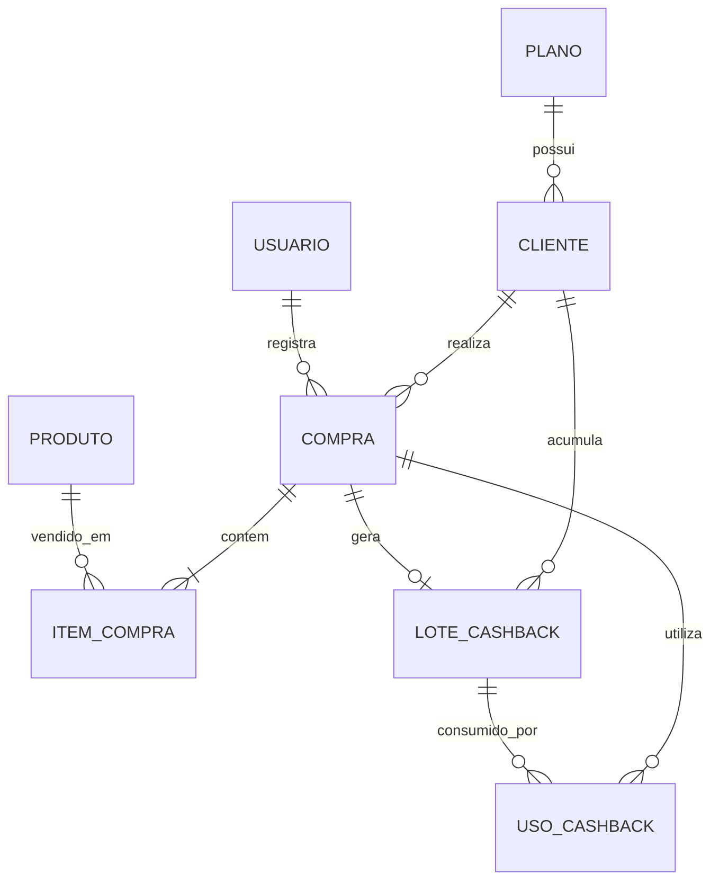

# Modelo de dados

Tabelas, campos e regras de integridade do banco, e como as migrations são tratadas. As regras que originam cada ponto estão em [regrasDeNegocio.md](../negocio/regrasDeNegocio.md), e os tetos de valor em [contratos.md](../api/contratos.md).

- **Versão:** 0.4
- **Data:** 2026-11-06
- **Status:** `aprovado`.

---

## 1. Princípios

| # | Princípio |
|---|---|
| 1 | Banco **MySQL 8.4**, acessado só pelo Prisma. |
| 2 | Toda tabela tem `id` inteiro com autoincremento. As tabelas de **cadastro** (`Usuario`, `Plano`, `Produto`, `Cliente`) têm `criadoEm` e `atualizadoEm`. As de **registro** (`Compra`, `LoteCashback`, `UsoCashback`) têm só a data do fato: `criadaEm`, `geradoEm` e `criadoEm`. O `ItemCompra` não tem data, porque vale a da compra. O `LoteCashback` muda (saldo e status) sem `atualizadoEm`, porque cada mudança de saldo já fica registrada, com data, em `UsoCashback`. |
| 3 | **Dinheiro** em `Int`, em centavos. **Percentual** em `Int`, em pontos-base. |
| 4 | **Datas e horas** gravadas em UTC. |
| 5 | **Nada é apagado.** Cliente, plano e produto têm o campo `ativo`, e "excluir" é desativar. |
| 6 | Models em `PascalCase` no singular, campos em `camelCase`, valores de enum em maiúsculas. |
| 7 | Chaves estrangeiras **sem apagar em cascata**: não se remove um registro que outro usa. |

## 2. Tabelas

### Usuario
| Campo | Tipo | Observação |
|---|---|---|
| `id` | inteiro | |
| `nome` | texto (120) | |
| `email` | texto (190) | **Único.** |
| `senhaHash` | texto (255) | Só o hash. |
| `perfil` | enum | `ADMIN` ou `ATENDENTE`. |
| `ativo` | booleano | Padrão verdadeiro. |

### Plano
| Campo | Tipo | Observação |
|---|---|---|
| `id` | inteiro | |
| `nome` | texto (80) | **Único.** |
| `percentualBps` | inteiro | |
| `limiteCentavos` | inteiro | |
| `minimoUsoCentavos` | inteiro | |
| `dobroAniversario` | booleano | |
| `validadeDias` | inteiro | Padrão 180. |
| `ativo` | booleano | Padrão verdadeiro. |

### Produto
| Campo | Tipo | Observação |
|---|---|---|
| `id` | inteiro | |
| `nome` | texto (120) | **Único.** |
| `descricao` | texto | Opcional. |
| `precoCentavos` | inteiro | |
| `ativo` | booleano | Padrão verdadeiro. |

### Cliente
| Campo | Tipo | Observação |
|---|---|---|
| `id` | inteiro | |
| `nome` | texto (120) | |
| `email` | texto (190) | Opcional. **Único** quando existe. |
| `telefone` | texto (30) | Opcional. |
| `dataNascimento` | data | Opcional. |
| `planoId` | inteiro | Chave para `Plano`. |
| `ativo` | booleano | Padrão verdadeiro. |

### Compra
| Campo | Tipo | Observação |
|---|---|---|
| `id` | inteiro | |
| `clienteId` | inteiro | Chave para `Cliente`. |
| `usuarioId` | inteiro | Chave para `Usuario`: quem registrou. |
| `valorBrutoCentavos` | inteiro | |
| `cashbackUsadoCentavos` | inteiro | Padrão 0. |
| `valorPagoCentavos` | inteiro | |
| `cashbackGeradoCentavos` | inteiro | Padrão 0. |
| `cashbackCortadoCentavos` | inteiro | Parte cortada pelo limite do plano. Padrão 0. |
| `chaveIdempotencia` | texto (64) | **Único junto com `usuarioId`.** |
| `criadaEm` | data e hora | |

### ItemCompra
| Campo | Tipo | Observação |
|---|---|---|
| `id` | inteiro | |
| `compraId` | inteiro | Chave para `Compra`. |
| `produtoId` | inteiro | Chave para `Produto`. |
| `quantidade` | inteiro | |
| `precoUnitarioCentavos` | inteiro | Preço da época. |
| `subtotalCentavos` | inteiro | |

### LoteCashback
| Campo | Tipo | Observação |
|---|---|---|
| `id` | inteiro | |
| `clienteId` | inteiro | Chave para `Cliente`. |
| `compraOrigemId` | inteiro | Chave para `Compra`. **Único**: uma compra gera no máximo um lote. |
| `valorOriginalCentavos` | inteiro | |
| `saldoCentavos` | inteiro | O que sobra no lote. No lote expirado, o valor que expirou **fica registrado**. |
| `geradoEm` | data e hora | |
| `venceEm` | data e hora | |
| `status` | enum | `ATIVO`, `PARCIAL`, `CONSUMIDO` ou `EXPIRADO`. |

### UsoCashback
| Campo | Tipo | Observação |
|---|---|---|
| `id` | inteiro | |
| `compraId` | inteiro | Chave para `Compra`. |
| `loteId` | inteiro | Chave para `LoteCashback`. |
| `valorCentavos` | inteiro | Quanto esta compra tirou deste lote. |
| `criadoEm` | data e hora | |

## 3. Índices

| Tabela | Índice | Para quê |
|---|---|---|
| `Cliente` | `planoId` | Contar os clientes ativos de um plano. |
| `Produto` | `ativo` | Listar produtos ativos. |
| `Compra` | `clienteId` + `criadaEm`; `usuarioId` + `criadaEm` | Histórico por cliente e por usuário. |
| `Compra` | `usuarioId` + `chaveIdempotencia` (**único**) | Idempotência. |
| `ItemCompra` | `compraId`; `produtoId` | Itens de uma compra. |
| `LoteCashback` | `clienteId` + `status` + `venceEm`; `clienteId` + `geradoEm` | Escolher os lotes do FIFO e montar o extrato. |
| `UsoCashback` | `compraId`; `loteId` | Auditar o consumo de cada lote. |

## 4. Diagrama

## 5. Integridade

| # | Regra |
|---|---|
| 1 | O saldo de um lote nunca fica negativo. |
| 2 | A compra, os itens, os usos e o novo lote são gravados em **uma única transação**. |
| 3 | No início da transação da compra, a linha do cliente é **bloqueada** (`SELECT ... FOR UPDATE`), para duas compras do mesmo cliente não gastarem o mesmo saldo nem passarem do limite. |
| 4 | Lotes vencidos são marcados `EXPIRADO` só dentro da transação da compra. O **extrato não grava nada**: ele trata o lote vencido como expirado ao calcular. O saldo disponível soma só os lotes `ATIVO` ou `PARCIAL` que ainda não venceram. |
| 5 | Compras antigas guardam o preço da época nos itens, então mudar o preço de um produto não as altera. |
| 6 | A `chaveIdempotencia` é comparada de forma **exata** (`ABC` e `abc` são chaves diferentes). Nomes e e-mails únicos ignoram maiúsculas e acentos, o padrão do MySQL, para evitar duplicatas como "Café" e "Cafe". |
| 7 | Desativar um plano e vincular um cliente a ele (cadastro, reativação ou troca de plano) **bloqueiam a linha do plano** (`SELECT ... FOR UPDATE`), para a RN-05 nunca ser violada por duas operações ao mesmo tempo. |
| 8 | Na compra, o **instante de referência é obtido depois de conseguir o bloqueio do cliente** e vale para tudo: o saldo, os vencimentos, o aniversário, `criadaEm` e `geradoEm`. Assim, uma espera pelo bloqueio nunca mistura dois momentos. |

Os tetos de valor (preço, quantidade, valor bruto, limite do plano) estão em `contratos.md` e cabem em `Int`.

## 6. Migrations

| # | Regra |
|---|---|
| 1 | O schema do Prisma é a fonte do modelo, e cada mudança vira uma **migration**. |
| 2 | A primeira migration se chama `inicial` e cria as oito tabelas, os índices e as chaves. **Ela ainda não existe.** |
| 3 | Uma pessoa gera a migration e a commita. Migration já commitada **não é editada**: mudança de schema entra em migration nova (Bloco 5 do `aiRules.md`). |
| 4 | Os testes rodam em um **banco de teste próprio**, indicado pela variável `DATABASE_URL_TEST` (por exemplo, `grao_a_grao_teste`, criado local), nunca no banco compartilhado. As tabelas desse banco são criadas por `migrate deploy` apontando para `DATABASE_URL_TEST`. Cada teste limpa só as tabelas que usa, sem `migrate reset`. |

## 7. Carga inicial

| # | Regra |
|---|---|
| 1 | Existe uma carga inicial, rodada à mão uma vez por ambiente: `prisma/seed.ts`, pelo comando `npm run db:seed`. |
| 2 | Ela cria os **três planos iniciais** (Básico, Intermediário e Premium, com os valores da RN-03) e o **primeiro admin**. Nada mais: sem clientes, produtos ou compras de demonstração. |
| 3 | E-mail e senha do admin vêm das variáveis de ambiente `SEED_ADMIN_EMAIL` e `SEED_ADMIN_PASSWORD`, nunca do repositório. O nome é opcional (`SEED_ADMIN_NAME`, padrão "Administrador"). A senha segue a regra de 8 caracteres e é gravada como hash. |
| 4 | Pode rodar mais de uma vez sem duplicar: o plano é identificado pelo nome e o admin pelo e-mail. O que já existe **não é alterado**. |
| 5 | Sem as variáveis obrigatórias, a carga falha com uma mensagem clara. |
| 6 | Em banco compartilhado, só roda com autorização explícita (Bloco 5 do `aiRules.md`). |
